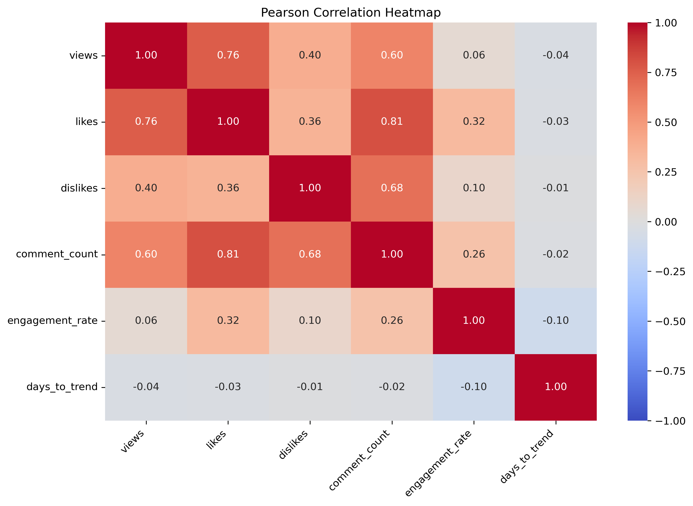
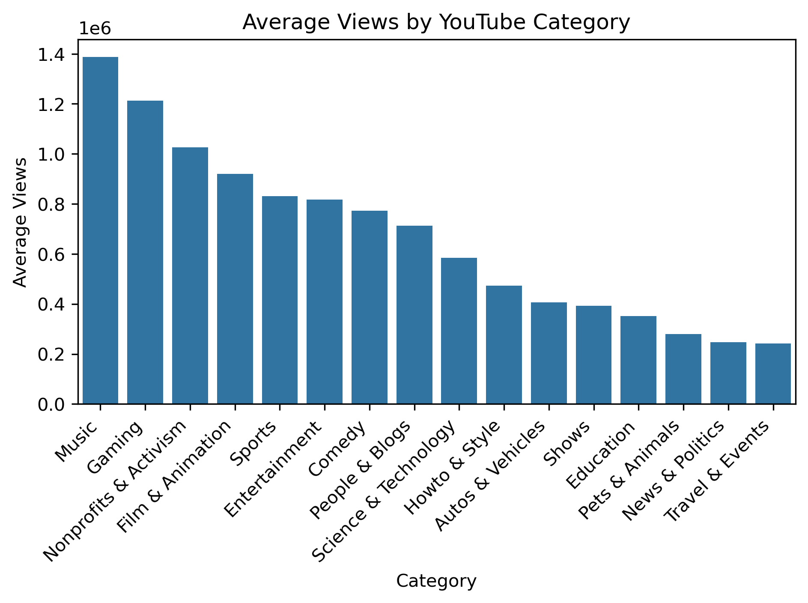
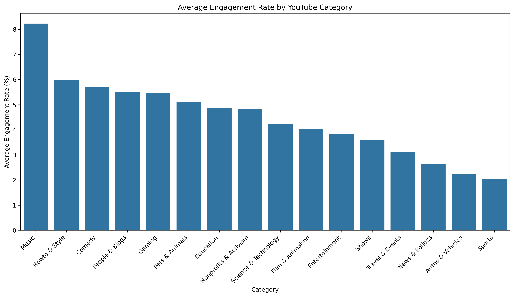
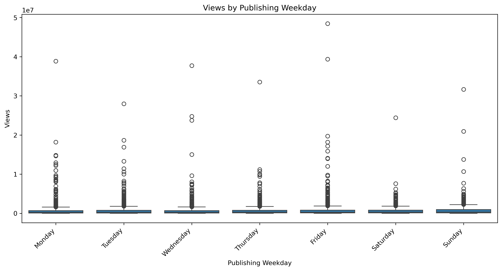
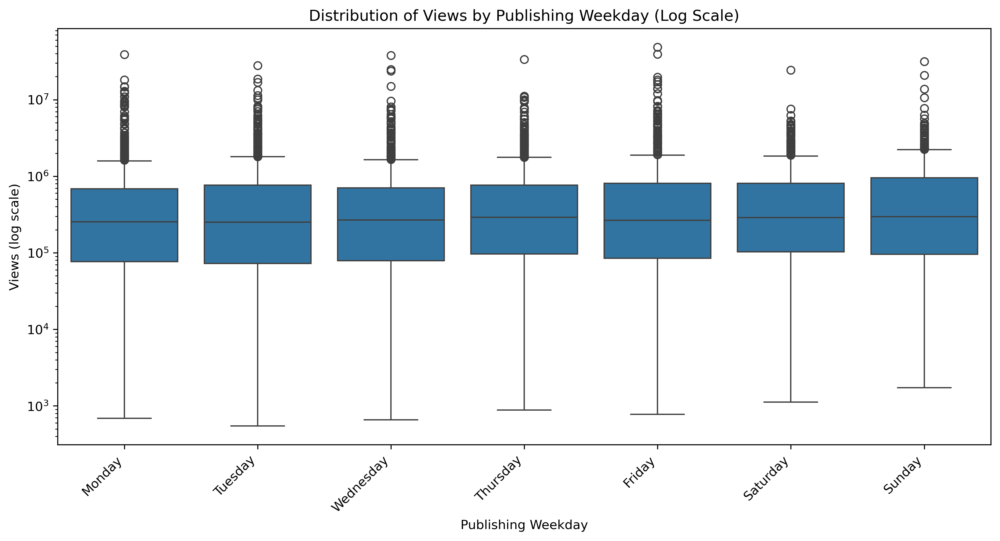
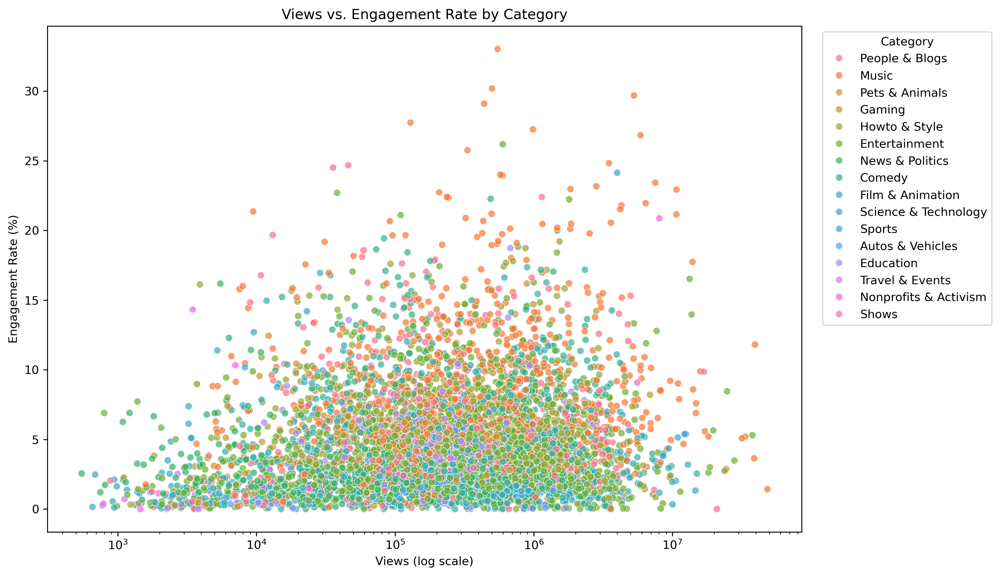

# YouTube Trending Videos: Engagement Analytics & Correlation Deep-Dive

**An Exploratory Data Analysis Project on Video Popularity, Audience Engagement, and Content Strategy**

This project investigates YouTube trending videos to explore relationships between video performance metrics, audience engagement, content categories, and publication timing. Using Python and statistical analysis, the project transforms raw data into interpretable findings supported by visualizations.


## Project Overview

Why do some YouTube videos attract millions of views while others generate more engagement relative to their audience size? Does performance differ across content categories? Can publication-day patterns provide useful insights for content planning?

This project explores these questions through an analysis of the US YouTube Trending Videos dataset.

Using Python, Pandas, NumPy, Matplotlib, and Seaborn, I performed data cleaning, feature engineering, correlation analysis, category comparisons, and weekday analysis. The project examines both video popularity and audience interaction to provide a broader understanding of content performance.

The goal is not only to identify statistical patterns, but also to translate them into practical recommendations that can inform further analysis and content strategy experiments.

### Project at a Glance

| Attribute | Description |
|---|---|
| Project type | Exploratory Data Analysis (EDA) |
| Domain | Data Analytics and Digital Content |
| Dataset | US YouTube Trending Videos |
| Original dataset size | 40,949 rows and 16 columns |
| Unique video IDs identified | 6,351 |
| Programming language | Python |
| Main libraries | Pandas, NumPy, Matplotlib, Seaborn |
| Environment | Jupyter Notebook |
| Main deliverables | Notebook, visualizations, exported CSV files, documentation |

## Project Objectives

The project focuses on six main objectives:

1. Assess the structure and quality of the dataset.
2. Create engagement-related metrics for comparing video performance.
3. Investigate relationships between views, likes, dislikes, comments, and metadata.
4. Compare average views and engagement across content categories.
5. Explore differences in video performance and engagement by publication weekday.
6. Develop evidence-based content strategy recommendations while recognizing the limitations of observational data.

## Dataset

The analysis uses two input files.

| File | Description |
|---|---|
| `USvideos.csv` | Contains video metadata, views, likes, dislikes, comments, tags, publication timestamps, trending dates, and category IDs |
| `US_category_id.json` | Contains category metadata used to map category IDs to readable names |

### Initial Data Assessment

The original CSV contained **40,949 rows and 16 columns**. Mapping category IDs to category names increased the dataset to 17 columns.

Initial data quality checks identified:

- 570 missing video descriptions.
- 48 exact duplicate rows.
- 6,351 unique video IDs.

For the video-level analysis, records were sorted by trending date and duplicate video IDs were removed while keeping the first occurrence. Consequently, the analysis represents one retained record per video rather than the complete daily history of each video's trending appearances.

## Technologies and Tools

| Technology | Purpose |
|---|---|
| Python | Data processing and analysis |
| Pandas | Data cleaning, transformation, grouping, and aggregation |
| NumPy | Numerical operations |
| Matplotlib | Data visualization |
| Seaborn | Statistical visualizations and correlation heatmaps |
| Jupyter Notebook | Interactive analysis and documentation |
| CSV and JSON | Input datasets and exported results |
| GitHub | Version control and project presentation |

## Project Structure

The repository separates source data, processed outputs, visualizations, and documentation.

```text
youtube-trending-analysis/
│
├── README.md
├── note.md
├── your_notebook.ipynb
│
├── data/
│   ├── USvideos.csv
│   └── US_category_id.json
│
├── output_data/
│   ├── cleaned_youtube_data.csv
│   ├── category_performance.csv
│   ├── weekday_comparison.csv
│   └── top_10_videos.csv
│
└── visuals/
    ├── pearson_correlation_heatmap.png
    ├── average_views_by_category.png
    ├── engagement_rate_by_category.png
    ├── views_by_publish_weekday.png
    ├── views_by_publish_weekday_log.png
    └── views_vs_engagement_by_category.png
```

Replace `your_notebook.ipynb` with the actual notebook filename. The listed filenames should match the files in your repository.

---

## Visual Gallery

The following charts are embedded directly from the `visuals/` directory. Once the PNG files are committed to GitHub at these paths, visitors can view them directly on the README page.

### 1. Correlation Analysis

The Pearson correlation heatmap summarizes linear relationships between selected video metrics, including views, likes, dislikes, comments, engagement rate, and days to trend.



**What this visualization reveals:**

- The relationship between views and likes.
- The association between comments and dislikes.
- Differences in the relationships among raw counts, rates, and time-based metrics.

**Interpretation:** Correlation helps identify statistical relationships, but it does not establish cause and effect.

### 2. Average Views by Category

This chart compares average video views across YouTube content categories.



**What this visualization reveals:**

- Which categories have higher average reach.
- How average views differ across categories.
- Why category performance should be interpreted alongside sample size and potential outliers.

**Interpretation:** Average views provide one measure of popularity, but a small number of exceptionally popular videos can influence category averages.

### 3. Engagement Rate by Category

This chart compares average engagement rates across content categories.



**What this visualization reveals:**

- Categories with higher average interactions relative to views.
- Differences between reach and engagement.
- Potential categories for further investigation.

**Interpretation:** High average views do not necessarily correspond to high engagement rates. These metrics capture different aspects of video performance.

### 4. Video Views by Publication Weekday

This boxplot compares the distribution of video views across publication weekdays.



**What this visualization reveals:**

- Differences in view distributions across weekdays.
- Variation between typical observations and extreme values.
- The presence of videos with exceptionally high view counts.

**Interpretation:** Weekday comparisons can generate hypotheses about publication timing, but differences may also reflect content categories, channel popularity, and other factors.

### 5. Video Views by Weekday on a Logarithmic Scale

Video views vary substantially, making a logarithmic scale useful for inspecting distributions across a wide range of values.



**What this visualization reveals:**

- The spread of views within each weekday.
- Differences that may be difficult to inspect on a standard scale.
- Variation among videos with very different levels of popularity.

**Interpretation:** Logarithmic scaling improves the visibility of patterns in highly skewed data without changing the underlying observations.

### 6. Views Versus Engagement Rate

This scatter plot explores the relationship between video views and engagement rate, with points distinguished by content category.



**What this visualization reveals:**

- Videos with high views but relatively low engagement.
- Videos with fewer views but comparatively high engagement.
- Differences and variation across content categories.
- Why popularity and audience interaction should be analyzed together.

**Interpretation:** A video can achieve broad reach without generating a similarly high proportion of interactions. The scatter plot helps illustrate this distinction.

---

## Key Findings

The following findings are based on the calculated results from the analyzed video-level dataset.

### 1. Views and Likes Have a Strong Positive Correlation

**Pearson correlation: 0.76**

Views and likes showed a strong positive linear relationship. Videos with more views generally tended to receive more likes in the analyzed records.

This association does not establish that increasing views directly causes more likes.

### 2. Music Leads in Average Views and Engagement

| Metric | Music |
|---|---:|
| Average views | 1,387,621.18 |
| Average engagement rate | 8.23% |
| Number of videos | 799 |

Music recorded the highest average views and average engagement rate among the categories in the category summary.

Howto & Style also demonstrated relatively high engagement, with an average engagement rate of **5.97%**.

These results describe the analyzed dataset and should not be interpreted as a guarantee of future performance.

### 3. High Popularity Does Not Necessarily Mean High Engagement

*Maluma – El Préstamo (Official Video)* received approximately **48.43 million views**, but its engagement rate was about **1.43%**.

This example illustrates the difference between reach and interaction relative to views.

- **Views** measure the scale of audience reach.
- **Engagement rate**, as defined in this project, measures likes, dislikes, and comments relative to views.

Evaluating both metrics provides a more complete perspective than relying on views alone.

### 4. Engagement Differs Across Publication Weekdays

| Weekday | Average engagement rate | Median engagement rate |
|---|---:|---:|
| Monday | 4.38% | 3.44% |
| Tuesday | 4.57% | 3.68% |
| Wednesday | 4.76% | 3.78% |
| Thursday | 5.02% | 3.99% |
| Friday | 5.24% | 4.06% |
| Saturday | 4.88% | 4.13% |
| Sunday | 4.32% | 3.41% |

Friday had the highest average engagement rate, while Sunday had the lowest. Saturday had the highest median engagement rate.

These differences may justify further investigation, but the analysis does not establish that publication weekday itself causes engagement to change.

### 5. Tag Count Has Almost No Linear Relationship with Views

**Pearson correlation: 0.04**

The number of tags had almost no linear relationship with views in this dataset.

This finding concerns tag quantity, not tag quality or relevance. It does not demonstrate that tags are unimportant.

### Additional Observation: Sample Size Matters

The Shows category contained only 4 videos, while Nonprofits & Activism contained 14 videos in the category summary.

Averages from small samples may be unstable, so these categories should be interpreted cautiously.

---

## Content Strategy Recommendations

The recommendations below are hypotheses informed by the observed patterns, not guaranteed formulas for success.

### 1. Evaluate Reach and Engagement Separately

Views show the scale of a video's audience, while engagement rate captures interactions relative to views.

**Recommendation:** Monitor views, engagement rate, like rate, and comments together. Avoid evaluating content performance using only one metric.

### 2. Investigate Successful Content Categories

Music performed strongly in both average views and engagement, while Howto & Style achieved a relatively high engagement rate.

**Recommendation:** Examine successful videos for their topics, formats, titles, thumbnails, presentation, and audience fit. Test relevant ideas in the intended channel rather than assuming that category averages will translate directly into results.

### 3. Treat Publication Timing as an Experiment

Friday had the highest average engagement rate in the analyzed sample.

**Recommendation:** Test comparable videos across different weekdays over a sustained period. Use channel-specific analytics and account for differences in topic, format, audience, and channel size before drawing conclusions.

### 4. Prioritize Relevant Metadata

The near-zero correlation between tag count and views suggests that adding more tags alone was not associated with higher view counts in this analysis.

**Recommendation:** Use accurate, relevant tags and clear titles and descriptions. Evaluate discovery performance using actual analytics rather than assuming that a larger tag count will increase views.

### 5. Match Metrics to Content Goals

Content designed to maximize awareness may have different objectives from content designed to encourage discussion or build a community.

**Recommendation:** Define the objective before evaluating performance. Use views to understand reach and engagement-related metrics to understand audience interaction.

### 6. Consider Outliers and Sample Sizes

Viral videos can strongly influence averages, while categories with few records provide less stable estimates.

**Recommendation:** Review median values and sample counts alongside averages. Compare similar videos and use larger datasets before making major strategic decisions.

---

## Methodology

The project follows a structured data analytics workflow.

### Step 1: Data Loading

Loaded the CSV dataset using Pandas and imported category metadata from JSON.

### Step 2: Data Quality Assessment

Examined missing values, exact duplicate rows, and unique video IDs.

### Step 3: Data Cleaning and Date Processing

Converted the trending date and publication timestamp columns to datetime formats. Sorted the data by trending date and retained one record per video ID.

### Step 4: Feature Engineering

Created the following analytical variables:

- `engagement_rate`
- `like_rate`
- `dislike_rate`
- `days_to_trend`
- `tags_count`

The engagement rate was calculated as:

`(likes + dislikes + comment_count) / views * 100`

The like rate was calculated as:

`likes / views * 100`

The dislike rate was calculated as:

`dislikes / views * 100`

The `days_to_trend` variable represents the calendar-day difference between the publication date and the retained trending date.

### Step 5: Correlation Analysis

Calculated Pearson correlation coefficients to investigate linear relationships between selected numerical metrics.

### Step 6: Category Aggregation

Grouped videos by category to calculate average views, average engagement rate, average like rate, and video counts.

### Step 7: Publication Weekday Analysis

Extracted publication weekdays and compared average views, median views, and engagement statistics across weekdays.

### Step 8: Top Video Analysis

Identified the ten videos with the highest view counts and examined their engagement metrics. Additional comparisons explored videos with relatively high views but low engagement and videos with relatively low views but high engagement.

### Step 9: Visualization and Export

Created the visualizations and exported the cleaned dataset and summary tables to CSV files for reuse.

---

## Data Outputs

The project separates original data, processed results, visualizations, and documentation.

### Input Data: `data/`

- `USvideos.csv`
- `US_category_id.json`

### Processed Results: `output_data/`

- `cleaned_youtube_data.csv` — processed video-level data and calculated metrics.
- `category_performance.csv` — category-level performance summary.
- `weekday_comparison.csv` — publication-weekday statistics.
- `top_10_videos.csv` — top-viewed videos and selected performance metrics.

### Visualizations: `visuals/`

- `pearson_correlation_heatmap.png`
- `average_views_by_category.png`
- `engagement_rate_by_category.png`
- `views_by_publish_weekday.png`
- `views_by_publish_weekday_log.png`
- `views_vs_engagement_by_category.png`

### Documentation

- `README.md` — project overview, visual gallery, findings, and execution instructions.
- `note.md` — detailed methodology, content strategy insights, limitations, and future improvements.

---

## How to Run the Project

### 1. Clone the Repository

```bash
git clone <your-repository-url>
cd youtube-trending-analysis
```

Replace `<your-repository-url>` with your actual GitHub repository URL.

### 2. Install Dependencies

```bash
pip install pandas numpy matplotlib seaborn jupyter
```

### 3. Verify the Project Structure

Ensure that the original datasets are located in the `data/` directory and that the notebook uses the correct relative paths.

For a notebook located in the repository root, a typical input path is:

```python
import pandas as pd

df = pd.read_csv("data/USvideos.csv")
```

### 4. Open the Notebook

Launch Jupyter Notebook:

```bash
jupyter notebook
```

Alternatively, open the notebook directly in VS Code.

### 5. Run the Analysis

Execute the notebook cells in order, from data loading and cleaning through feature engineering, analysis, visualization, and export.

Confirm that the generated CSV files are saved to `output_data/` and the chart images are saved to `visuals/`.

---

## Limitations

The findings should be interpreted in the context of several limitations:

- The analysis covers the available US trending-video dataset, not every YouTube upload.
- Retaining one record per video removes the daily history of repeated trending appearances from the later analysis.
- Correlation does not establish causation.
- Outliers and skewed distributions can influence averages and Pearson correlation values.
- Category averages based on small samples may be unstable.
- Tag count does not capture tag relevance or metadata quality.
- Publication weekday alone cannot explain engagement differences.
- The engagement rate used in this project includes likes, dislikes, and comments relative to views. It does not measure watch time, audience retention, shares, or overall sentiment.

## Future Improvements

Potential extensions include:

1. Analyze the complete daily trending history to investigate how individual videos change over time.
2. Compare median views and engagement across categories and channels.
3. Investigate video duration, title length, and additional metadata characteristics.
4. Use log transformations or robust statistics to reduce the influence of extreme values.
5. Test weekday patterns while accounting for category and channel differences.
6. Build and evaluate a predictive model using appropriate features and held-out data.
7. Develop an interactive dashboard for exploring category performance and engagement metrics.

## Detailed Documentation

For a deeper discussion of the methodology, interpretation of results, content strategy recommendations, limitations, and future improvements, see [note.md](note.md).

## Conclusion

This project demonstrates how exploratory data analysis can transform raw digital content data into interpretable findings.

The results show a strong positive relationship between views and likes, differences in category-level performance, and a distinction between popularity and engagement. The publication-weekday and tag-count analyses also provide useful questions for further investigation.

The broader lesson is that video performance should be evaluated through multiple metrics, with attention to sample size, data limitations, and the difference between correlation and causation.

Rather than treating the results as universal rules, the findings can inform further experiments and more detailed analysis using channel-specific data.

---
